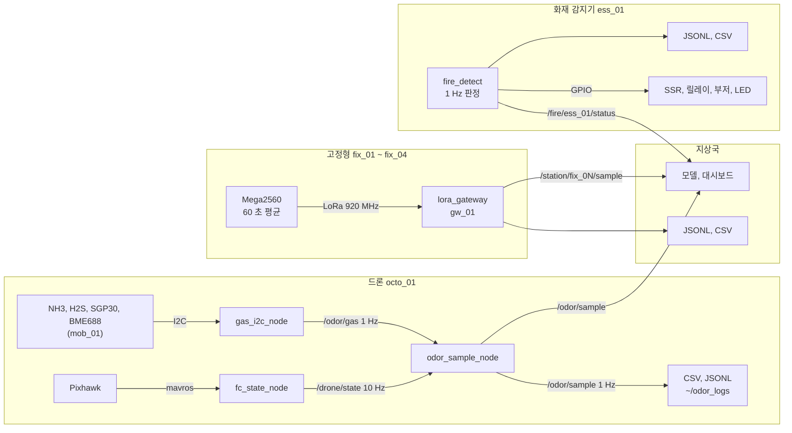

# 악취 모니터링 데이터 규격 v0.2

세림씨앤에스 악취 감지 드론과 거치형 시스템이 주고받는 데이터의 형식입니다.
하드웨어(드론, 관측소, 화재 감지기)와 소프트웨어(모델, 대시보드)가 이 문서 하나로 약속을 맞춥니다.

| 항목 | 내용 |
|---|---|
| 규격 버전 | 0.2 (2026-10-09). v0.1 (YoungHyun1884/drone_stink) 과 호환 |
| 원본 | `ros2_ws/src/odor_msgs/msg/*.msg` 가 단일 원본. 이 문서의 필드 표와 JSON Schema 는 여기서 자동 생성 |
| JSON Schema | `interfaces/schemas/*.schema.json` (draft 2020-12) |
| 예시 | `interfaces/examples/*.json` (종류별 한 건), `tools/fake_jsonl.py` (시간 순 묶음) |
| 검사 도구 | `python3 tools/validate_jsonl.py <파일>` |
| 저장소 | moving-ver (이 규격, 이동형), stable-ver (고정형, 게이트웨이), fire_detect (화재 감지기) |

---

## 1. 한눈에



소프트웨어 쪽이 받는 것은 세 가지입니다.

| 무엇 | ROS 2 토픽 | 파일 (JSONL) | 주기 |
|---|---|---|---|
| 드론 지오태깅 샘플 | `/odor/sample` (OdorSample) | `~/odor_logs/odor_*.jsonl` (드론 Pi) | 1 초 |
| 고정형 관측소 측정 | `/station/fix_0N/sample` (StationSample) | `gateway_YYYYmmdd.jsonl` (지상국) | 60 초 |
| 화재 감지기 상태 | `/fire/ess_01/status` (FireStatus) | `fire_YYYYmmdd.jsonl` (감지기 Pi) | 1 초 (파일은 10 초) |
| 장비 상태 | `/health/<장비 ID>` (DeviceHealth) | 위 파일들에 섞여 있음 | 10 초 (고정형 10 분) |

ROS 2 와 파일은 내용이 같습니다. ROS 를 쓰지 않는 쪽은 JSONL 만 읽으면 됩니다 (6장).

---

## 2. 공통 규칙

### 2.1 장비 ID

| ID | 장비 | 비고 |
|---|---|---|
| `octo_01` | 드론 기체 (Pixhawk) | OdorSample, DroneState 의 frame_id |
| `mob_01` | 드론에 단 악취 센서 묶음 | GasReading 의 frame_id |
| `fix_01` ~ `fix_04` | 고정형 관측소 | LoRa 패킷의 station 번호 1~4 |
| `ess_01` | 화재 감지기 | |
| `gw_01` | 지상국 LoRa 게이트웨이 | |

형식은 `^[a-z][a-z0-9]*_[0-9]{2}$` 입니다. 소문자, 밑줄, 두 자리 번호. ROS 2 토픽 이름에 하이픈을 쓸 수 없어서
v0.1 의 `octo-01`, `gas-01` 을 `octo_01`, `mob_01` 로 바꿨습니다 (10장).

### 2.2 시각

- 모든 시각은 **UTC** 입니다. 현지 시각(KST)은 화면에 보여 줄 때만 바꿉니다.
- JSON: ISO 8601, 밀리초까지, 끝에 `Z`. 예: `2026-10-10T05:12:33.120Z`
- ROS 2: `header.stamp` (builtin_interfaces/Time)
- CSV: `time_unix` (epoch 초, 소수 3자리) 와 `time_iso` (위 JSON 형식) 를 같이 씁니다.
- LoRa: uint32 epoch 초. `0` 이면 관측소 시계를 모르는 것이고, 게이트웨이가 받은 시각으로 바꿉니다.
- 시계를 믿을 수 없으면 flags 의 `TIME_UNSYNCED`(bit6) 를 켭니다.
  Pi 는 NTP 동기가 안 됐을 때, 고정형은 RTC 가 설정되지 않았거나 게이트웨이 시각과 5 분 넘게 다를 때입니다.
- `stamp` 는 측정 시각입니다. 고정형은 60 초 평균 창이 끝난 시각입니다.

### 2.3 단위

| 값 | 단위 | 값 | 단위 |
|---|---|---|---|
| NH3, H2S, eCO2 | ppm | TVOC | ppb |
| VOC Index, NOx Index | 없음 (1~500) | 온도 | ℃ |
| 습도 | % (상대습도 0~100) | 기압 | hPa |
| 가스 저항 | Ω | 먼지 | µg/m³ |
| 전압 | V | 위도, 경도 | deg (WGS84, float64) |
| 고도 | m | 각도 | deg |

### 2.4 값이 없을 때

| 어디서 | 표시 |
|---|---|
| ROS 2 float 필드 | `NaN` |
| JSON | `null` |
| CSV | 빈 칸 |
| LoRa | 정해진 값 (u16 `0xFFFF`, i16 `-32768`, i32 `-2147483648`) |

- 장비에 원래 없는 센서의 값은 그냥 비워 둡니다 (예: 이동형의 `voc_index`). INVALID 비트는 켜지 않습니다.
- **있어야 할 값을 못 읽었을 때**만 그 값을 비우고 해당 INVALID 비트를 켭니다 (예: `NH3_INVALID`).
- 정수, bool, 문자열 필드는 비울 수 없습니다. 의미가 정해진 값을 씁니다 (`hotspot_index` 255, `rssi_dbm` 0, `battery_percent` -1).

### 2.5 버전과 호환

- 모든 JSON 기록에 `"version": "0.2"` 가 들어갑니다.
- **기존 필드는 이름, 타입, 순서를 바꾸지 않고 지우지도 않습니다.** 새 필드는 메시지 맨 뒤에만 붙입니다.
  그래서 v0.1 코드(drone_stink)는 v0.2 메시지를 받아도 그대로 동작합니다.
- 필드를 추가하면 버전의 두 번째 자리를 올립니다 (0.3). 뜻을 바꾸는 변경은 하지 않는 것이 원칙이고,
  꼭 필요하면 첫 자리를 올리고 이 문서 10장에 적습니다.
- .msg 를 고친 뒤에는 `python3 tools/gen_schemas.py && python3 tools/gen_docs.py && python3 -m pytest tests` 를 돌립니다.

---

## 3. 토픽

| 토픽 | 타입 | 보내는 쪽 | 주기 |
|---|---|---|---|
| `/drone/state` | DroneState | fc_state_node (또는 fake_fc_node) | 10 Hz |
| `/odor/gas` | GasReading | gas_i2c_node (또는 gas_sensor_node, fake_gas_node) | 1 Hz |
| `/odor/sample` | OdorSample | odor_sample_node | 1 Hz (가스 측정마다) |
| `/station/<fix_0N>/sample` | StationSample | lora_gateway | 관측소마다 60 초 |
| `/fire/ess_01/status` | FireStatus | fire_detect `--ros` | 1 Hz |
| `/health/<장비 ID>` | DeviceHealth | 각 장비, 고정형은 게이트웨이가 대신 | 10 초 (고정형 10 분) |

QoS 는 모두 기본값(reliable, depth 10)입니다. 같은 네트워크에서 `ROS_DOMAIN_ID` 만 맞추면 보입니다.

---

## 4. 메시지

### 4.1 DroneState

드론 비행 컨트롤러 상태 요약. v0.1 과 같고, v0.2 부터 위치를 모르면 0 대신 NaN 입니다.

<!-- gen:fields DroneState -->
| 필드 (JSON 키) | ROS 타입 | JSON 타입 | 설명 |
|---|---|---|---|
| `stamp` | header.stamp | string (UTC ISO 8601) | stamp: 발행 시각(RPi 시계), frame_id: 드론 ID |
| `device_id` | header.frame_id | string | 장비 ID (2.1) |
| `armed` | bool | boolean |  |
| `mode` | string | string | 비행모드 문자열 (예: LOITER, AUTO, GUIDED, RTL) |
| `in_air` | bool | boolean | 공중이면 true, 지상이면 false |
| `latitude` | float64 | number \| null | deg, WGS84. 모르면 NaN |
| `longitude` | float64 | number \| null | deg. 모르면 NaN |
| `altitude_msl` | float32 | number \| null | m, 해수면 기준 |
| `altitude_rel` | float32 | number \| null | m, 이륙 지점 기준 |
| `heading_deg` | float32 | number \| null | 0~360, 북쪽이 0, 시계방향 + |
| `gps_fix_type` | uint8 | integer 0~255 | 0~1: fix 없음, 2: 2D, 3: 3D, 4~6: DGPS/RTK |
| `gps_satellites` | uint8 | integer 0~255 | 사용 위성 수 |
| `roll_deg` | float32 | number \| null |  |
| `pitch_deg` | float32 | number \| null |  |
| `yaw_deg` | float32 | number \| null | ENU 기준(동쪽이 0, 반시계 +). 방위는 heading_deg 를 쓸 것 |
| `ground_speed_mps` | float32 | number \| null | m/s |
| `climb_rate_mps` | float32 | number \| null | m/s, 상승이 + |
| `battery_voltage` | float32 | number \| null | V |
| `battery_current` | float32 | number \| null | A, 방전 중일 때 양수 |
| `battery_percent` | float32 | number \| null | 0~100, FC 추정치. 모르면 -1 |
<!-- /gen -->

### 4.2 GasReading

악취 센서 1회 측정값. 이동형은 1 초 순간값, 고정형은 60 초 평균(StationSample 안).
앞 8개는 v0.1 그대로이고 `eco2_ppm` 부터가 v0.2 추가입니다.

<!-- gen:fields GasReading -->
| 필드 (JSON 키) | ROS 타입 | JSON 타입 | 설명 |
|---|---|---|---|
| `stamp` | header.stamp | string (UTC ISO 8601) | stamp: 측정 시각(UTC), frame_id: 장비 ID (mob_01, fix_01 ...) |
| `device_id` | header.frame_id | string | 장비 ID (2.1) |
| `h2s_ppm` | float32 | number \| null | 황화수소 ppm |
| `nh3_ppm` | float32 | number \| null | 암모니아 ppm |
| `tvoc_ppb` | float32 | number \| null | 총휘발성유기화합물 ppb (SGP30. SGP41 은 이 값을 못 냄 -> NaN) |
| `temperature_c` | float32 | number \| null | 측정 공기 온도 ℃ |
| `humidity_pct` | float32 | number \| null | 측정 공기 상대습도 0~100 % |
| `pump_on` | bool | boolean | 흡입 펌프 동작 여부 (펌프 없는 장비는 false) |
| `payload_voltage` | float32 | number \| null | 센서 모듈 전원 전압 V (측정 안 하면 NaN) |
| `eco2_ppm` | float32 | number \| null | SGP30 eCO2 추정값 ppm (실제 CO2 센서 아님) |
| `voc_index` | float32 | number \| null | SGP41 VOC Index 1~500, 평소 100. 단위 없음 |
| `nox_index` | float32 | number \| null | SGP41 NOx Index 1~500, 평소 1. 단위 없음 |
| `pressure_hpa` | float32 | number \| null | 기압 hPa (BME688) |
| `gas_resistance_ohm` | float32 | number \| null | BME688 가스 저항 Ω (낮을수록 VOC 많음) |
| `pm1_0_ugm3` | float32 | number \| null | PMS7003 PM1.0 µg/m³ (대기 환산값) |
| `pm2_5_ugm3` | float32 | number \| null | PMS7003 PM2.5 µg/m³ |
| `pm10_ugm3` | float32 | number \| null | PMS7003 PM10 µg/m³ |
| `nh3_raw` | float32 | number \| null | NH3 원신호 (재보정용, 분석에는 쓰지 말 것). 고정형: 증폭 회로 출력 µV, 이동형: 온도 보정 전 ppm |
| `h2s_raw` | float32 | number \| null | H2S 원신호 (재보정용, 분석에는 쓰지 말 것). 고정형: 증폭 회로 출력 µV, 이동형: 온도 보정 전 ppm |
| `flags` | uint16 | integer 0~65535 | 품질 비트 (아래 상수). 0 이면 모두 정상 |
<!-- /gen -->

**flags (품질 비트).** 0 이면 모두 정상. 여러 비트가 같이 켜질 수 있습니다.

<!-- gen:consts GasReading FLAG_ -->
| 상수 | 값 | 비트 | 뜻 |
|---|---|---|---|
| `FLAG_WARMUP` | 1 | bit0 | 센서 예열 중 |
| `FLAG_NH3_INVALID` | 2 | bit1 | 암모니아 값 무효 |
| `FLAG_H2S_INVALID` | 4 | bit2 | 황화수소 값 무효 |
| `FLAG_VOC_INVALID` | 8 | bit3 | VOC, TVOC, eCO2 무효 (SGP 초기화, 학습 중) |
| `FLAG_TH_INVALID` | 16 | bit4 | 온습도 무효 |
| `FLAG_PM_INVALID` | 32 | bit5 | 먼지 무효 |
| `FLAG_TIME_UNSYNCED` | 64 | bit6 | 측정 시각을 믿을 수 없음 (RTC 미설정, NTP 미동기) |
| `FLAG_ZERO_CAL` | 128 | bit7 | 영점 보정 중. 외기 측정값이 아님 |
| `FLAG_PURGE` | 256 | bit8 | 챔버 퍼지 중. 외기 측정값이 아님 |
| `FLAG_PUMP_ON` | 512 | bit9 | 펌프 동작 (pump_on 과 같은 값) |
| `FLAG_TEMP_COMP` | 1024 | bit10 | 가스 값에 온도 보정 적용됨 (하나라도. 원값은 *_raw) |
| `FLAG_SIMULATED` | 2048 | bit11 | 가짜 데이터 (fake 노드, 시뮬레이터) |
<!-- /gen -->

분석할 때는 보통 `flags & (WARMUP | ZERO_CAL | PURGE | SIMULATED)` 가 0 인 기록만 씁니다.
`ZERO_CAL`, `PURGE` 는 챔버 방식 고정형에서 깨끗한 공기를 재는 구간이라 외기 값이 아닙니다.

**장비별로 채우는 값**

| 필드 | 이동형 mob_01 | 고정형 fix_0N |
|---|---|---|
| nh3_ppm | Gravity SEN0469 (보드가 ppm 으로 줌) | ME3-NH3 + 증폭 회로. **감도를 설정하기 전에는 null** |
| h2s_ppm | Gravity SEN0467 | 110-303 + 증폭 회로 (명목 감도 200 nA/ppm) |
| tvoc_ppb, eco2_ppm | SGP30 | null |
| voc_index, nox_index | null | SGP41 |
| temperature_c, humidity_pct | BME688 | SHT31 |
| pressure_hpa, gas_resistance_ohm | BME688 | null |
| pm1_0, pm2_5, pm10 | null | PMS7003 |
| pump_on | false | 챔버 방식에서 펌프 동작 중이면 true |
| payload_voltage | null | null (전원 전압은 DeviceHealth.supply_v) |
| nh3_raw, h2s_raw | 온도 보정 전 ppm | 증폭 회로 출력 µV (영점 보정 전) |

**온도 보정 (이동형 Gravity).** 제조사 라이브러리의 온도 보정식은 H2S 의 20 ℃ 초과 구간이
`ppm / (0.015 t - 0.3)` 이라 20 ℃ 에서 0 으로 나누게 되고 25 ℃ 에서 13 배가 됩니다. 믿기 어려워서
기본은 **보정하지 않고** 센서가 준 값을 그대로 씁니다 (`TEMP_COMP` 꺼짐, `*_raw` 와 같음).
NH3 만 보정하려면 `config/mob_01.yaml` 의 `temp_comp: "NH3"`. 보정했으면 `TEMP_COMP` 가 켜지고 원값은 `*_raw` 에 남습니다.

### 4.3 OdorSample

지오태깅된 이동형 샘플 = 가스 측정값 + 그 순간의 드론 상태. 소프트웨어는 이동형 데이터를 이 토픽 하나로 받으면 됩니다.

<!-- gen:fields OdorSample -->
| 필드 (JSON 키) | ROS 타입 | JSON 타입 | 설명 |
|---|---|---|---|
| `stamp` | header.stamp | string (UTC ISO 8601) | stamp: 가스 측정 시각(UTC), frame_id: 드론 ID (octo_01) |
| `device_id` | header.frame_id | string | 장비 ID (2.1) |
| `drone` | DroneState | object (DroneState, [DroneState](#dronestate)) | 측정 순간의 드론 위치, 자세, 배터리 |
| `gas` | GasReading | object (GasReading, [GasReading](#gasreading)) | 가스 측정값 |
| `drone_age_s` | float32 | number \| null | 붙인 드론 상태가 몇 초 전 것인지. 2 초를 넘으면 위치를 믿지 말 것 |
<!-- /gen -->

- `drone_age_s` = 가스 측정 시각 - 붙인 드론 상태의 시각. 2 초가 넘으면 위치를 믿지 마십시오.
- 드론 상태를 한 번도 못 받았으면(FC 연결 안 됨) 샘플을 버리지 않고 위치를 null, `drone_age_s` 를 null 로 보냅니다.

### 4.4 StationSample

고정형 관측소 1회 보고. 관측소가 60 초 평균을 LoRa 로 보내면 게이트웨이가 설치 좌표를 붙여 만듭니다.

<!-- gen:fields StationSample -->
| 필드 (JSON 키) | ROS 타입 | JSON 타입 | 설명 |
|---|---|---|---|
| `stamp` | header.stamp | string (UTC ISO 8601) | stamp: 평균 창의 끝 시각(관측소 RTC, UTC), frame_id: 관측소 ID (fix_01) |
| `device_id` | header.frame_id | string | 장비 ID (2.1) |
| `latitude` | float64 | number \| null | deg, WGS84. 설치 좌표 (게이트웨이 stations.yaml) |
| `longitude` | float64 | number \| null | deg |
| `altitude_msl` | float32 | number \| null | m |
| `sampling_mode` | uint8 | integer 0~255 | MODE_DIFFUSION 또는 MODE_CHAMBER |
| `avg_window_s` | uint16 | integer 0~65535 | 몇 초 동안의 평균인지 (보통 60) |
| `gas` | GasReading | object (GasReading, [GasReading](#gasreading)) | 측정값. gas.header 는 위 header 와 같다. 품질은 gas.flags |
| `seq` | uint16 | integer 0~65535 | 관측소 패킷 순번. 건너뛰면 그만큼 손실 |
| `rssi_dbm` | int16 | integer | 게이트웨이 수신 세기 dBm. 0 = 모름 |
| `received` | builtin_interfaces/Time | string (UTC ISO 8601) | 게이트웨이가 받은 시각(UTC) |
<!-- /gen -->

<!-- gen:consts StationSample MODE_ -->
| 상수 | 값 | 비트 | 뜻 |
|---|---|---|---|
| `MODE_DIFFUSION` | 0 |  | 자연 확산 (통기구) |
| `MODE_CHAMBER` | 1 |  | 챔버 + 펌프 흡입 |
<!-- /gen -->

- 위치는 관측소가 보내지 않습니다. 게이트웨이의 `stations.yaml` 에 적은 설치 좌표입니다. 없으면 null.
- `seq` 가 건너뛰면 그만큼 패킷을 잃은 것입니다 (16비트라 65535 다음은 0).
- `gas.stamp`, `gas.device_id` 는 바깥 `stamp`, `device_id` 와 같습니다.

### 4.5 FireStatus

화재 감지기(소형 ESS 충전 과열 감시) 상태.

<!-- gen:fields FireStatus -->
| 필드 (JSON 키) | ROS 타입 | JSON 타입 | 설명 |
|---|---|---|---|
| `stamp` | header.stamp | string (UTC ISO 8601) | stamp: 판정 시각(UTC), frame_id: 장비 ID (ess_01) |
| `device_id` | header.frame_id | string | 장비 ID (2.1) |
| `level` | uint8 | integer 0~255 | 위 LEVEL_* 4 단계 (0 정상 ~ 3 위험) |
| `latched` | bool | boolean | 위험 단계가 걸려 사람이 해제할 때까지 유지되는 중 |
| `ambient_temp_c` | float32 | number \| null | 주변 온도 ℃ (SHT31). 뜨거운 화소 판정의 기준선 |
| `ambient_rh_pct` | float32 | number \| null | 주변 상대습도 % |
| `surface_max_c` | float32 | number \| null | 표면 64 화소 중 최고 ℃ |
| `surface_mean_c` | float32 | number \| null | 표면 64 화소 평균 ℃ |
| `surface_min_c` | float32 | number \| null | 표면 64 화소 중 최저 ℃ |
| `hot_pixels` | uint8 | integer 0~255 | (화소 온도 > 주변 + delta_c) 인 화소 개수 0~64 |
| `hotspot_index` | uint8 | integer 0~255 | 최고 화소 위치 0~63 = 행 * 8 + 열. 255 = 없음 |
| `delta_c` | float32 | number \| null | 판정에 쓴 ΔT ℃ (설정값) |
| `abs_limit_c` | float32 | number \| null | 판정에 쓴 절대 한계 ℃ (설정값) |
| `smoke_v` | float32 | number \| null | MQ-2 출력 전압 V (분압 보정 후 실제 AO 전압) |
| `smoke_baseline_v` | float32 | number \| null | 깨끗한 공기 기준 전압 V (정상 단계에서 천천히 학습) |
| `smoke_detected` | bool | boolean | smoke_v 가 기준보다 설정값 이상 올라감 |
| `charge_allowed` | bool | boolean | AC SSR 통전 중 = 충전 허용. false = 차단 |
| `dc_allowed` | bool | boolean | DC 릴레이 통전 중 |
| `buzzer_on` | bool | boolean | 부저가 울리는 중 (연속 또는 간헐) |
| `flags` | uint16 | integer 0~65535 | 아래 비트. bit6, bit11 은 GasReading 과 같은 뜻 |
| `thermal_c` | float32[64] | array[64] of number \| null | 8x8 화소 온도 ℃, 행 우선 (0 번이 왼쪽 위) |
<!-- /gen -->

<!-- gen:consts FireStatus LEVEL_ -->
| 상수 | 값 | 비트 | 뜻 |
|---|---|---|---|
| `LEVEL_NORMAL` | 0 |  | 정상: 주변보다 뜨거운 화소 없음. 녹색 LED |
| `LEVEL_CAUTION` | 1 |  | 주의: 뜨거운 화소 1~2개 (국부 발열). 황색 LED |
| `LEVEL_WARNING` | 2 |  | 경고: 뜨거운 화소 3개 이상 (번지는 중). 적색 점멸, 부저 간헐 |
| `LEVEL_DANGER` | 3 |  | 위험: 연기 또는 절대 한계 초과. 적색 상시, 부저 연속, 충전 차단 |
<!-- /gen -->

<!-- gen:consts FireStatus FLAG_ -->
| 상수 | 값 | 비트 | 뜻 |
|---|---|---|---|
| `FLAG_SMOKE_WARMUP` | 1 | bit0 | MQ-2 예열 중이라 연기 판정을 끔 |
| `FLAG_AMG_INVALID` | 2 | bit1 | 열화상 읽기 실패 |
| `FLAG_SHT_INVALID` | 4 | bit2 | 온습도 읽기 실패 (주변 온도 대신 화소 최저값 사용) |
| `FLAG_ADC_INVALID` | 8 | bit3 | 연기 ADC 읽기 실패 |
| `FLAG_TIME_UNSYNCED` | 64 | bit6 | 시각을 믿을 수 없음 |
| `FLAG_SIMULATED` | 2048 | bit11 | 가짜 데이터 |
<!-- /gen -->

- 뜨거운 화소 = 화소 온도가 `ambient_temp_c + delta_c` 를 넘는 화소. 1~2 개 주의, 3 개 이상 경고.
- 위험 단계는 래치됩니다 (`latched`). 조건이 사라져도 사람이 버튼(2 초)이나 `fire-detect --reset` 으로 풀 때까지 유지합니다.
- `charge_allowed` 가 false 면 파워뱅크 충전 AC 라인(SSR)이 끊긴 상태입니다. 열화상을 10 초 넘게 못 읽어도 끊습니다.
- `thermal_c` 는 8x8 화소를 행 우선으로 늘어놓은 것입니다. 0 번이 어느 모서리인지는 카메라 장착 방향에 따라 다릅니다.
- `delta_c`, `abs_limit_c` 는 판정에 쓴 설정값입니다 (기본 8 ℃, 60 ℃. 정상 충전 기록으로 다시 정할 예정).

### 4.6 DeviceHealth

모든 장비의 상태 보고(하트비트). 대시보드는 이것으로 "살아 있나, 센서가 다 붙어 있나" 를 봅니다.

<!-- gen:fields DeviceHealth -->
| 필드 (JSON 키) | ROS 타입 | JSON 타입 | 설명 |
|---|---|---|---|
| `stamp` | header.stamp | string (UTC ISO 8601) | stamp: 보고 시각(UTC), frame_id: 장비 ID |
| `device_id` | header.frame_id | string | 장비 ID (2.1) |
| `state` | uint8 | integer 0~255 | 위 STATE_* (0 막 켜짐 ~ 4 측정 불가) |
| `firmware` | string | string | 소프트웨어 이름과 버전 (예: fix_station 0.2.0) |
| `uptime_s` | uint32 | integer | 켜진 뒤 경과 초 |
| `sensor_ok_mask` | uint16 | integer 0~65535 | 센서별 정상 비트. 비트 뜻은 장비마다 다름 (DATA_SPEC.md 4.6 표) |
| `error_count` | uint16 | integer 0~65535 | 켜진 뒤 누적 오류 수 |
| `supply_v` | float32 | number \| null | 전원 전압 V. 모르면 NaN |
| `cpu_temp_c` | float32 | number \| null | CPU 온도 ℃ (Pi 만). 모르면 NaN |
| `rssi_dbm` | int16 | integer | LoRa 수신 세기 dBm (게이트웨이가 채움). 0 = 모름 |
| `message` | string | string | 최근 오류를 사람이 읽을 수 있게. 없으면 빈 문자열 |
<!-- /gen -->

<!-- gen:consts DeviceHealth STATE_ -->
| 상수 | 값 | 비트 | 뜻 |
|---|---|---|---|
| `STATE_BOOT` | 0 |  | 막 켜짐 |
| `STATE_WARMUP` | 1 |  | 센서 예열 중 |
| `STATE_OK` | 2 |  | 정상 |
| `STATE_DEGRADED` | 3 |  | 일부 센서 실패, 나머지는 동작 |
| `STATE_ERROR` | 4 |  | 측정 불가 |
<!-- /gen -->

**sensor_ok_mask 비트 (장비마다 다름)**

| 비트 | 이동형 mob_01 | 고정형 fix_0N | 화재 감지기 ess_01 | 게이트웨이 gw_01 |
|---|---|---|---|---|
| bit0 (1) | Gravity NH3 | ADS1115 (전기화학 증폭 출력) | AMG8833 열화상 | LoRa 수신 포트 |
| bit1 (2) | Gravity H2S | SGP41 | SHT31 | |
| bit2 (4) | SGP30 | SHT31 | ADS1115 (MQ-2) | |
| bit3 (8) | BME688 | PMS7003 | | |
| bit4 (16) | TCA9548A 멀티플렉서 | DS3231 RTC | | |
| bit5 (32) | | EEPROM 보정값 | | |

`supply_v` 는 이동형, 화재 감지기는 Pi5 의 5 V 입력 전압, 고정형은 VIN 분압 측정값입니다.

---

## 5. 장비와 파일

| 장비 | 소프트웨어 | 남기는 파일 (날짜, 시각은 UTC) |
|---|---|---|
| 이동형 (드론 Pi5) | moving-ver `odor_drone` (ROS 2 Jazzy) | `~/odor_logs/odor_YYYYmmdd_HHMMSSZ.csv`, `.jsonl` (실행마다 새 파일) |
| 고정형 (Mega2560) | stable-ver `firmware/fix_station` | 없음. USB 시리얼로 1 초 CSV 출력 (시험용) |
| 지상국 게이트웨이 | stable-ver `gateway` (`odor-gateway`) | `gateway_YYYYmmdd.jsonl`, `station_fix_0N_YYYYmmdd.csv` |
| 화재 감지기 (Pi5) | fire_detect (`fire-detect`) | `fire_YYYYmmdd.csv`, `thermal_YYYYmmdd.csv`, `fire_YYYYmmdd.jsonl` |

---

## 6. JSON 기록 (JSONL)

파일 한 줄이 기록 하나입니다. ROS 메시지와 1:1 로 대응하고 아래 규칙으로 바꿉니다
(`interfaces/python/odor_json.py` 가 이 규칙의 구현이고 세 저장소에 같은 파일이 있습니다).

1. 최상위에 `"type"` (메시지 이름의 snake_case: `odor_sample`, `station_sample`, `fire_status`, `device_health`, `gas_reading`, `drone_state`) 과 `"version": "0.2"`.
2. `header` 는 `"stamp"` (UTC ISO 문자열) 와 `"device_id"` 두 키로 풉니다.
3. 메시지 안의 메시지(OdorSample.drone 등)는 객체가 되고, 그 안에도 `stamp`, `device_id` 가 있습니다. `type`, `version` 은 없습니다.
4. builtin_interfaces/Time 필드(StationSample.received)는 UTC ISO 문자열.
5. float 의 NaN 은 `null`. 정의되지 않은 키는 넣지 않습니다 (스키마가 거부합니다).
6. float32 필드는 가장 짧은 십진수로 씁니다 (24.010000228881836 이 아니라 24.01).

예시 (`interfaces/examples/station_sample.json`):

```json
{
  "type": "station_sample", "version": "0.2",
  "stamp": "2026-10-10T05:12:33.120Z", "device_id": "fix_01",
  "latitude": 35.8242, "longitude": 127.148, "altitude_msl": 40.0,
  "sampling_mode": 0, "avg_window_s": 60,
  "gas": {
    "stamp": "2026-10-10T05:12:33.120Z", "device_id": "fix_01",
    "h2s_ppm": 0.012, "nh3_ppm": 1.23, "tvoc_ppb": null,
    "temperature_c": 18.62, "humidity_pct": 71.3,
    "pump_on": false, "payload_voltage": null,
    "eco2_ppm": null, "voc_index": 112.0, "nox_index": 1.0,
    "pressure_hpa": null, "gas_resistance_ohm": null,
    "pm1_0_ugm3": 8.0, "pm2_5_ugm3": 13.0, "pm10_ugm3": 21.0,
    "nh3_raw": 14760.0, "h2s_raw": 240.0, "flags": 0
  },
  "seq": 1287, "rssi_dbm": -87,
  "received": "2026-10-10T05:12:34.420Z"
}
```

검사:

```bash
pip install "jsonschema>=4.18"
python3 tools/validate_jsonl.py ~/odor_logs/odor_20261010_051233Z.jsonl
```

---

## 7. CSV 열

사람이 엑셀로 보기 위한 파일입니다. 프로그램으로 처리할 때는 JSONL 을 권합니다.
모든 CSV 는 첫 줄이 열 이름이고, 값이 없으면 빈 칸입니다.

**이동형** `odor_*.csv` (앞 28 열은 v0.1 과 같은 이름, 같은 순서)

```
time_unix,time_iso,drone_id,armed,mode,in_air,lat,lon,alt_msl_m,alt_rel_m,heading_deg,gps_fix,gps_sats,
roll_deg,pitch_deg,yaw_deg,ground_speed_mps,climb_rate_mps,batt_v,batt_a,batt_pct,
h2s_ppm,nh3_ppm,tvoc_ppb,temp_c,hum_pct,pump_on,payload_v,
drone_age_s,sensor_id,eco2_ppm,voc_index,nox_index,pressure_hpa,gas_res_ohm,pm1_0,pm2_5,pm10,nh3_raw,h2s_raw,flags
```

**고정형** `station_fix_0N_*.csv` (게이트웨이)

```
time_unix,time_iso,station_id,seq,rssi_dbm,received_iso,sampling_mode,avg_window_s,lat,lon,
nh3_ppm,h2s_ppm,tvoc_ppb,eco2_ppm,voc_index,nox_index,temp_c,hum_pct,pressure_hpa,pm1_0,pm2_5,pm10,
nh3_raw,h2s_raw,pump_on,flags
```

**화재 감지기** `fire_*.csv` 와 `thermal_*.csv`

```
time_unix,time_iso,device_id,level,latched,ambient_c,rh_pct,max_c,mean_c,min_c,hot_pixels,hotspot,
delta_c,abs_limit_c,smoke_v,smoke_baseline_v,smoke,charge_allowed,dc_allowed,buzzer,flags,fault,reason

time_unix,time_iso,p00,p01,...,p63
```

---

## 8. LoRa 패킷 v1 (고정형 -> 게이트웨이)

자세한 바이트 배치와 시험 벡터는 `stable-ver/protocol/LORA_PACKET.md`. 요약만 적습니다.

- E220 투명 모드, 9600 bps UART. 리틀 엔디언.
- 프레임: `A5 5A` + version(1) + type + station 번호 + seq(u16) + time(u32 epoch) + len + 페이로드 + CRC(u16)
- CRC-16/CCITT-FALSE (다항식 0x1021, 초기값 0xFFFF), version 부터 페이로드 끝까지. `"123456789"` -> `0x29B1`
- type `0x01` SAMPLE (페이로드 38 B, 프레임 52 B), `0x02` HEALTH (16 B, 프레임 30 B), `0x03` 예약 (이동형용, 11장)
- 값은 정수로 줄여 싣습니다: NH3 0.01 ppm, H2S 0.001 ppm, 온도 0.01 ℃, 습도 0.01 %, 기압 0.1 hPa, 나머지 1 단위
- 관측소는 `(번호 x 7) mod 60` 초에 보냅니다 (fix_01 7 초, fix_02 14 초 ...). 같은 채널에서 겹치지 않게.

게이트웨이가 패킷을 4.4 StationSample, 4.6 DeviceHealth 기록으로 바꿉니다.

---

## 9. 받는 쪽 예시

**ROS 2 (Python)**

```python
import rclpy
from odor_msgs.msg import OdorSample, GasReading

def on_sample(s: OdorSample):
    g = s.gas
    if g.flags & (GasReading.FLAG_WARMUP | GasReading.FLAG_SIMULATED):
        return                                   # 예열 중, 가짜 데이터는 건너뜀
    print(s.drone.latitude, s.drone.longitude, g.nh3_ppm, g.h2s_ppm)

rclpy.init()
node = rclpy.create_node("dashboard")
node.create_subscription(OdorSample, "/odor/sample", on_sample, 10)
rclpy.spin(node)
```

**JSONL (pandas)**

```python
import json, pandas as pd
rows = [json.loads(x) for x in open("gateway_20261010.jsonl")]
st = pd.json_normalize([r for r in rows if r["type"] == "station_sample"])
st["stamp"] = pd.to_datetime(st["stamp"], utc=True).dt.tz_convert("Asia/Seoul")   # 화면 표시용 KST
st = st[(st["gas.flags"] & 2433) == 0]                    # 예열(1), 영점(128), 퍼지(256), 가짜(2048) 제외
print(st.pivot_table(index="stamp", columns="device_id", values="gas.nh3_ppm"))
```

하드웨어 없이 개발하려면 가짜 데이터를 씁니다.

```bash
python3 tools/fake_jsonl.py --minutes 30 --fire-event --out sample.jsonl   # 파일로
ros2 launch odor_drone fake.launch.py                                       # ROS 토픽으로 (이동형)
odor-gateway --simulate --speed 60 --ros                                    # ROS 토픽으로 (고정형 4 개소)
fire-detect --simulate overheat --speed 10 --ros                            # ROS 토픽으로 (화재 감지기)
```

---

## 10. 변경 내역

### v0.2 (2026-10-09)

**호환되는 변경 (v0.1 코드 수정 없이 동작)**

- GasReading 맨 뒤에 필드 10 개와 `flags` 추가 (eco2_ppm, voc_index, nox_index, pressure_hpa, gas_resistance_ohm, pm1_0_ugm3, pm2_5_ugm3, pm10_ugm3, nh3_raw, h2s_raw)
- OdorSample 맨 뒤에 `drone_age_s` 추가
- 새 메시지: StationSample, FireStatus, DeviceHealth
- 새 토픽: `/station/<id>/sample`, `/fire/<id>/status`, `/health/<id>`
- 새 노드: gas_i2c_node (센서를 Pi5 I2C 에 직결). 아두이노 시리얼 방식 gas_sensor_node 도 그대로 둠

**확인이 필요한 변경**

- 장비 ID: `octo-01` -> `octo_01`, `gas-01` -> `mob_01` (ROS 토픽 이름 규칙). ID 를 문자열로 비교하는 코드가 있으면 고칠 것
- CSV `time_iso`: 현지 시각(시간대 표시 없음) -> UTC (끝에 `Z`). `time_unix` 는 그대로
- CSV 값 없음: `nan` -> 빈 칸
- CSV 파일 이름의 시각: 현지 시각 -> UTC (`odor_20261010_051233Z.csv`)
- 위치를 모르면 0.0 -> NaN (GPS fix 없음, FC 미연결)
- FC 상태 없이 가스 값만 있어도 OdorSample 을 보냄 (위치 null). v0.1 은 버렸음
- fake_gas_node 의 `pump_on` true -> false (이동형 설계에서 펌프가 빠짐), `flags` 에 SIMULATED

### v0.1

YoungHyun1884/drone_stink 의 DroneState, GasReading(8 필드), OdorSample(3 필드).

---

## 11. 정해야 할 것

| 항목 | 현재 | 결정 필요 |
|---|---|---|
| 고정형 흡입 방식 | 자연 확산(`MODE_DIFFUSION`) 기본. 챔버 + 펌프(`MODE_CHAMBER`)도 펌웨어와 규격이 지원 | 3D 프린트 챔버로 갈지. 챔버면 영점 보정용 활성탄 필터 구매 |
| 고정형 설치 좌표 | `stations.yaml` 에 임시 좌표 | 설치 후 실측 좌표 입력 |
| ME3-NH3 감도 | 미설정 -> 고정형 `nh3_ppm` 이 null (원신호 `nh3_raw` 만 있음) | 센서 라벨 또는 성적서의 nA/ppm 을 `set nh3_sens` 로 입력 |
| 110-303 감도 | 명목값 200 nA/ppm (개체 편차 ±37 %) | 라벨 값으로 교체 |
| 이동형 LoRa | 결선 도면에는 E220 이 있으나 소프트웨어는 ROS 2 네트워크와 로컬 파일로 보냄 | 쓸 거면 패킷 type `0x03` (위치 포함 요약, 10 초마다) 을 정의 |
| Pi5 시각 | NTP 가 없으면 `TIME_UNSYNCED` | 현장에서 쓸 시각원 (Pi5 RTC 배터리, GPS 시각, 지상국 NTP) |
| 화재 판정 기준값 | delta_c 8 ℃, abs_limit_c 60 ℃, smoke_dv 0.3 V (임시) | 정상 충전 기록 며칠 -> `fire_detect/tools/analyze_log.py` |
| Gravity 온도 보정 | 끔 | NH3 만 켤지 |
| 대시보드 수신 경로 | 같은 네트워크의 ROS 2 DDS | 현장망이 LTE 등이면 rmw_zenoh 또는 MQTT 브리지 |
